# 🚀 Star Citizen 基本入坑白嫖與避雷指南

> **免踩雷教學** — 因為太多人因為某些文章不小心踩雷，整理這篇讓新手少走冤枉路。

---

<h2>📌 0. 基本概念補充</h2>

 

<!-- [!IMPORTANT]-->
> 不要問 AI！遊戲仍在開發階段，改動幅度大，**問群友最準，不要怕問問題。**

- **灰市（Star Hanger / 8591 等）基本上不建議**，價格通常是實際市值的 2–3 倍以上。有時候問群友反而更划算。

---

### 🎁 Gift 功能

Gift 功能（見附圖右下角）可將網頁機庫內的物品以「轉移連結」方式發送至對方帳號信箱，**信用點購買的物品無法使用此功能**。

<!-- [!NOTE]-->
> 使用 Gift 功能的流程：進入網頁機庫 → 選擇物品 → 點選右下 Gift → 輸入對方信箱

1. 進入 RSI 網頁機庫選擇物品
2. 點選右下角 Gift 按鈕
3. 輸入對方帳號信箱發送連結

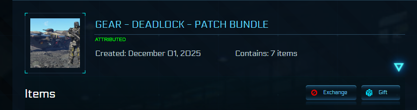
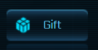

---

### 🔗 邀請碼

邀請碼是每個玩家都能發出的，新玩家可在以下位置使用：
- 註冊連結網址後方
- 官方註冊頁面內的欄位

> **範例連結：** [`https://www.robertsspaceindustries.com/enlist?referral=STAR-KYGD-H4NG`](https://www.robertsspaceindustries.com/enlist?referral=STAR-KYGD-H4NG)

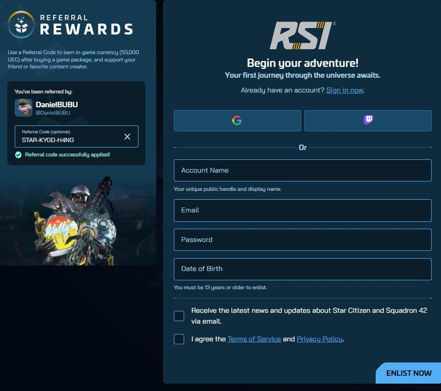

---

<h2>🌟 1. 新手入坑優勢</h2>

 

<!-- [!TIP]-->
> ~~有填寫邀請碼的帳號，在活動期間內**首次消費滿 $40 美金**，可獲贈最高價值 $40 的 LTI 載具。~~
>
> **更新：** CIG 目前似乎不再主動贈送新手載具，目前僅剩開小號或參與抽獎活動的方式取得。

送的船不喜歡也沒關係，可以透過「升級（CCU）」換成其他船（後面章節會說明融與 CCU 概念）。LTI 功能目前尚未確定，請自行上網查詢最新資訊。

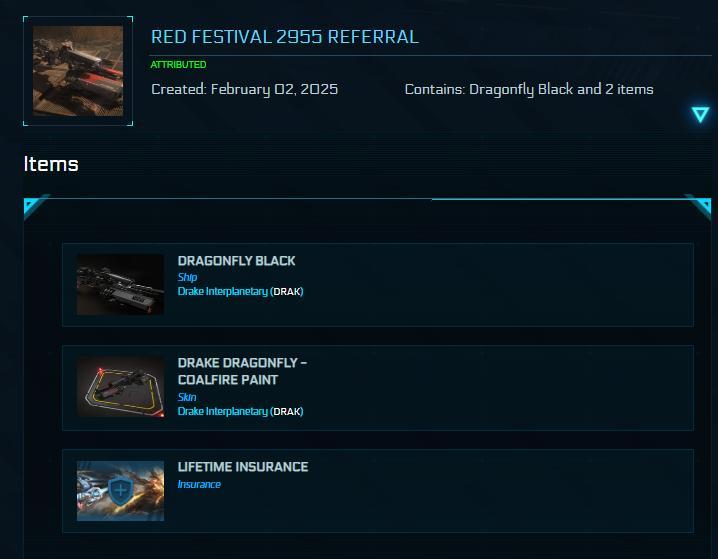

---

### 新手籌碼清單

- 🎟️ **邀請碼** — 新手少數能使用的談判籌碼，「遊騎兵」那邊有附優質教學，巴哈上也有人送遊戲幣一千萬，能白嫖的盡量用
- 🤝 **群友支援** — 若群友抽不出身教學，可以直接叫你填邀請碼的玩家負責
- 💰 **30 天退款** — 網站購買的所有東西 30 天內皆可申請退款

<!-- [!NOTE]-->
> 這個遊戲有**免費試飛活動（Free Fly）**，不想搞退款的話可以等活動期間免費體驗，覺得值得再購買遊戲包。
> ~~個人以通用性來說推薦泰坦包，能載貨也能戰鬥。~~

---

<h2>🎮 2. 進入遊戲後</h2>

 

不管是免費試玩期間還是正式購買後，下載好遊戲時有幾個注意事項：

### ⌨️ 基本操作注意

<!-- [!WARNING]-->
> **請務必使用全英文輸入法！**
>
> 漢化盒子有潛在盜號風險，風險自負。

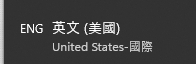

---

### 📋 重要提示清單

<!-- [!CAUTION] -->
> **極度、非常、超級建議跳過新手教學！** 裡面的 bug 可能會觸發「黃金體驗」。

| 按鍵 | 功能 |
|------|------|
| **長按 F** | 使用游標點擊按鈕（右鍵有更多選項） |
| **輕點 F** | 與幾乎所有有提示的物件互動 |
| **長按 / 輕點 Z** | 轉頭（船上也適用） |
| **F4** | 切換視角（船上也適用） |
| **I** | 開啟物品欄 |
| **滑鼠滾輪**（行走時）| 調整行走速度 |

<!-- [!TIP]-->
> 長按 F 使用游標的功能在飛床下線、泰坦爬梯下船等場景都需要用到！

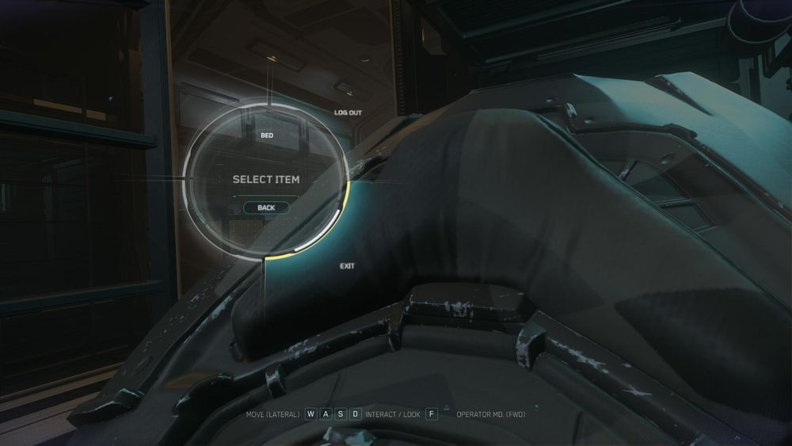

---

### 🎒 物品與裝備

- 目前版本**穿在身上看得到的裝備不會掉落**，左側物品欄內的才有機會噴裝
- 4.7 版物品 UI 更新後裝備穿脫介面已相當直觀

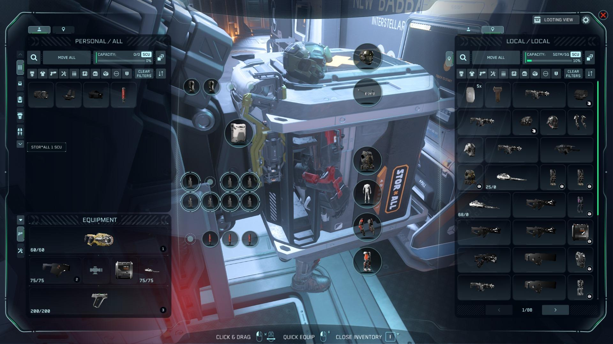

物品 UI 有兩種模式（**Loot** 和 **Inventory**），點選切換按鈕可以轉換：

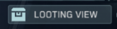
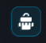

<!-- [!NOTE]-->
> **彈夾要對槍名**，確認口徑與型號一致再購買。

---

### 🏙️ 重生點設定

- 如果初始重生點在**派羅（Pyro）**，不需要特地上太空站設點
- 如果在**史丹頓（Stanton）**，建議前往太空站設點，下次上線時載入較快
- 現版本會直接重生在個人主城機庫內，不熟悉的話可以先問群友

---

<h2>🛸 3. 上床 / 船 / 太空站</h2>

 

現在你已經會走路和基本 FPS 操作了！通過 ASOP 面板叫機之後，準備上船出發。

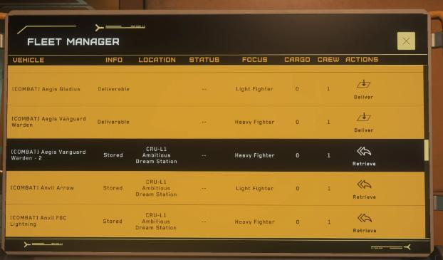

---

### 🅿️ 叫機注意事項

<!-- [!IMPORTANT]-->
> 在機場大廳叫載具，**一定要等載具標示「出來」後再坐電梯過去**。
>
> 最保險的叫船方法：叫完之後**馬上收船**（讓機庫在電梯列表刷出），再坐電梯進機庫重新叫船，可大幅降低飛機在機庫內 breaking 的機率。

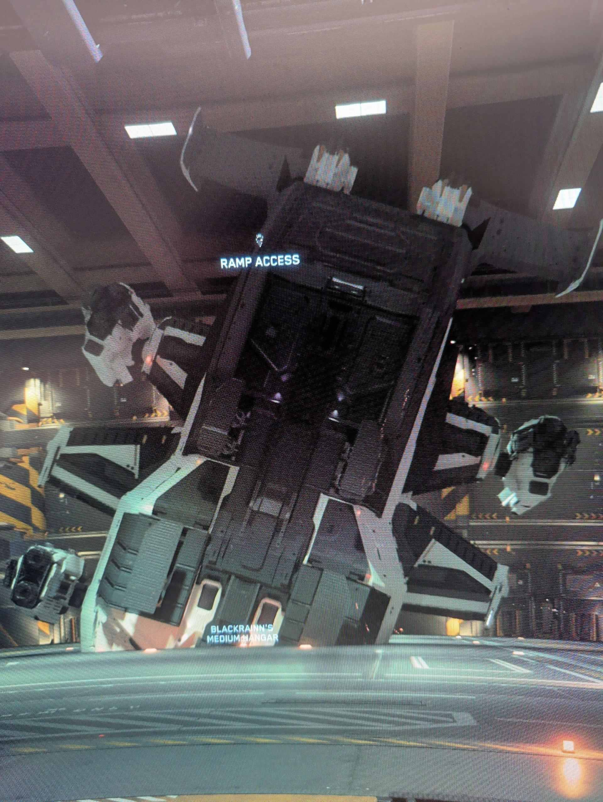

- **有床的船** 可以躺下長按 F 右鍵下線，下次上線時可以和船一起生出來
- **駕駛座快捷鍵：** `U` 開關電源、`I` 開關引擎
- 開電源後，幾乎所有面板都可以用游標操作，武器與護盾可以分配電量

---

### ✈️ 飛行基本操作

| 按鍵 | 功能 |
|------|------|
| `Space` / `Ctrl` | 上升 / 下降 |
| `WASD` | 前後左右平移 |
| `Q` / `E` | 滾轉 |
| `N` | 起落架（注意：收起時預設會解除限速） |
| `Alt+N` | 快捷鍵或機上通訊面板呼叫機庫降落 |
| `長按 B` | 切換 NAV 與 SCM 模式 |
| `C` | 開關 Couple 模式（關閉後飛船不會自動懸停） |
| `滑鼠中鍵` | 切換戰鬥模式與 NAV 模式 |
| `F2`（駕駛座）| 開啟導航介面 |
| `長按 X` | 空中減速，加快進入懸停狀態 |
| `Alt+滑鼠滾輪` | 手動降低限速 |

> 起落架指示燈
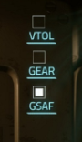

<!-- [!TIP]-->
> - NAV 模式下對準導航點**按左鍵**可跳躍
> - **SCM 模式**才能使用護盾與武器
> - 盡量不要對著有障礙物的方向飛

> NAV 模式與 SCM 模式
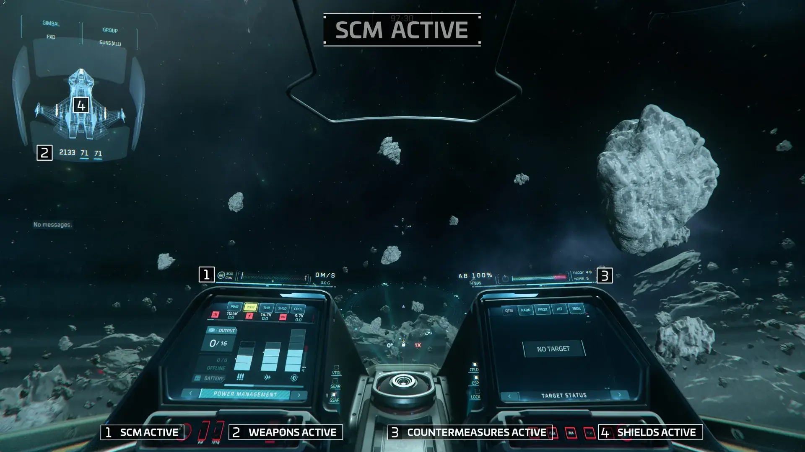
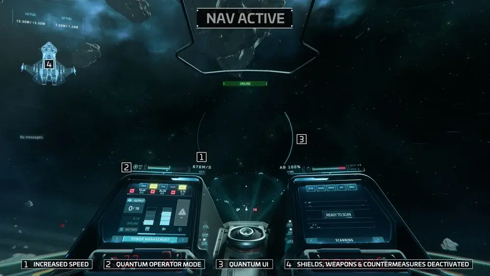

> 導航介面與跳躍校準
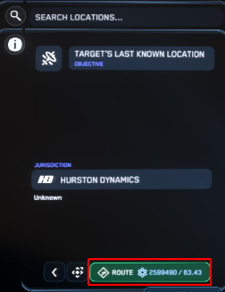
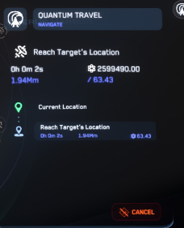
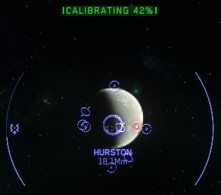

> 限速調整
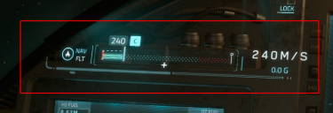

---

### 🔄 SCM / NAV 模式介紹

| 模式 | 特性 |
|------|------|
| **NAV 模式** | 限速較高，可鎖點量子跳躍，但無盾無槍 |
| **SCM 模式** | 護盾與武器可用，適合戰鬥與精細操作 |

<!-- [!NOTE]-->
> 滑鼠中鍵可以在 SCM 模式與 NAV 模式中切換副模式。
> 參考官方說明：[Master Modes Guide](https://robertsspaceindustries.com/en/comm-link/transmission/20053-Master-Modes-Guide)

---

### 🏥 太空站設重生點

1. 降落後坐電梯進入太空站內部
2. 前往**同一樓層的醫院**找保險面板
3. 點選設置重生點

點擊展開查看圖片

 

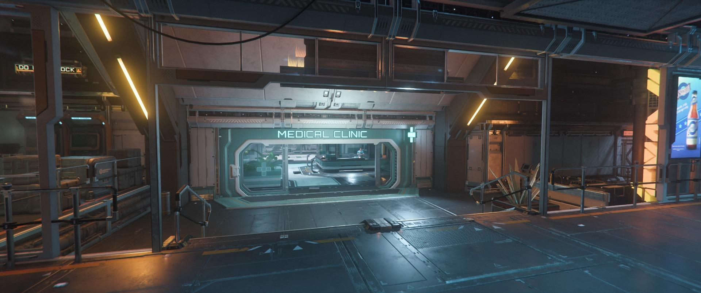
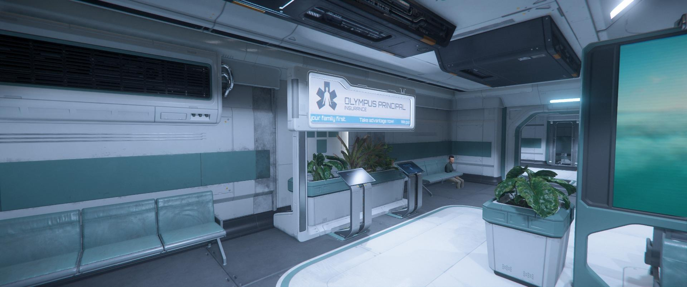
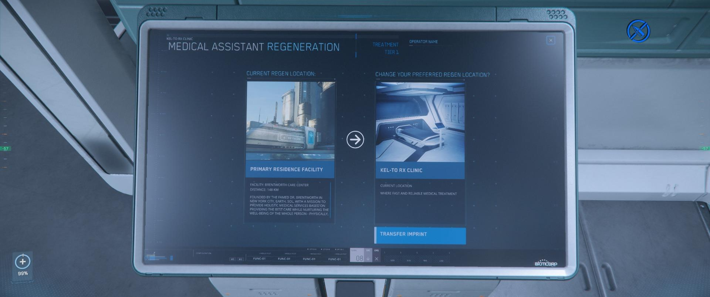

---

### 🛒 太空站購買清單

<!-- [!NOTE]-->
> **`Backspace` 長按**可強制重生，在船上使用相當於自爆，請謹慎操作。

以下裝備可在**太空站貨運甲板（Cargo Deck）** 購買：

| 物品 | 說明 |
|------|------|
| **Maxlift** | 牽引大槍，用於移動大型貨箱 |
| **Multitool** | 小型多功能工具槍 |
| **Tractor 模組** | 小型牽引模組 |
| **SCU 箱** | 標準貨運容器 |

點擊展開查看圖片

 

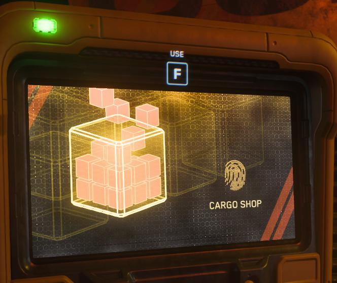
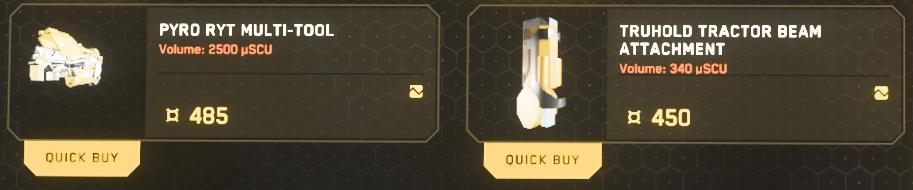
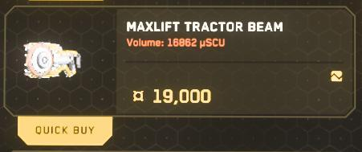
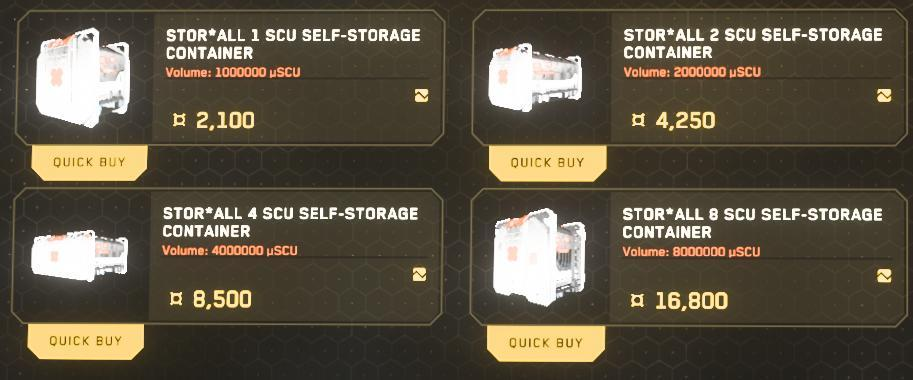

<!-- [!TIP]-->
> **醫療槍（ParaMed）** 在醫院（設重生點的地方附近）販售。

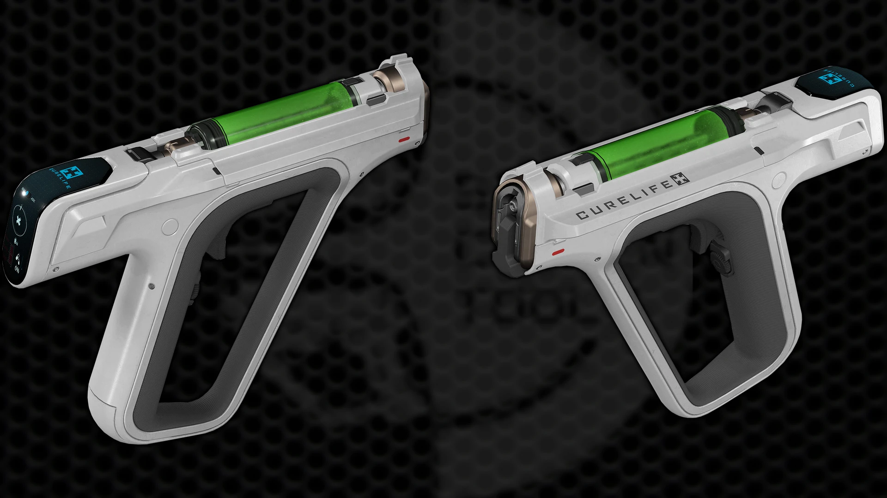

- `Alt+H` 可脫下頭盔，記得用完要戴回去
- 網站購買的東西 **30 天內**都可以申請退款

---

<h2>📋 4. 第一個合約任務 / 其他</h2>

 

其他攻略通常建議直接去接打架任務，但個人建議先做**貨運任務**來熟悉操作。

<!-- [!TIP]-->
> 按 **F1** → Contract 頁籤可以接合約任務。

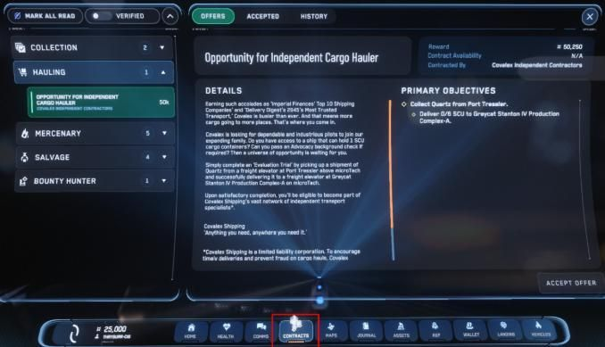

### 其他基本操作補充

| 操作 | 說明 |
|------|------|
| 滑鼠中鍵 | 近身將對方擊倒 |
| 對屍體按 F | 像打開箱子一樣檢查遺體物品 |
| Gateway | 可跳躍至其他星系，詳細請洽群友 |

<!-- [!NOTE]-->
> - 部分地面任務有**敵對防空砲塔**，請注意
> - 遊戲內的物品理論上短時間不會洗白，目前有將近一年的紀錄，但跨版本時船與物品仍有機會被吃掉
> - 逃獄與各版本執法系統機制，請洽群友

---

<h3>⛽ 4-1. 人物 / 飛船救援</h3>

 

<h4>🛢️ 4-1-1. 飛船加油</h4>

 

首先你需要有一艘**油船（Refueling Ship）**，並在能補給的地方點選 Manual 將油桶加滿。

> **加油流程：**

**Step 1 — 加油前準備**

在補給站將油桶加滿：

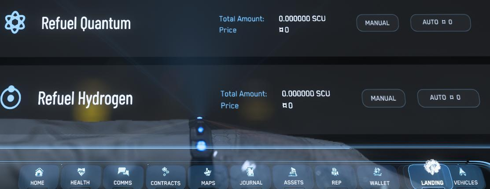
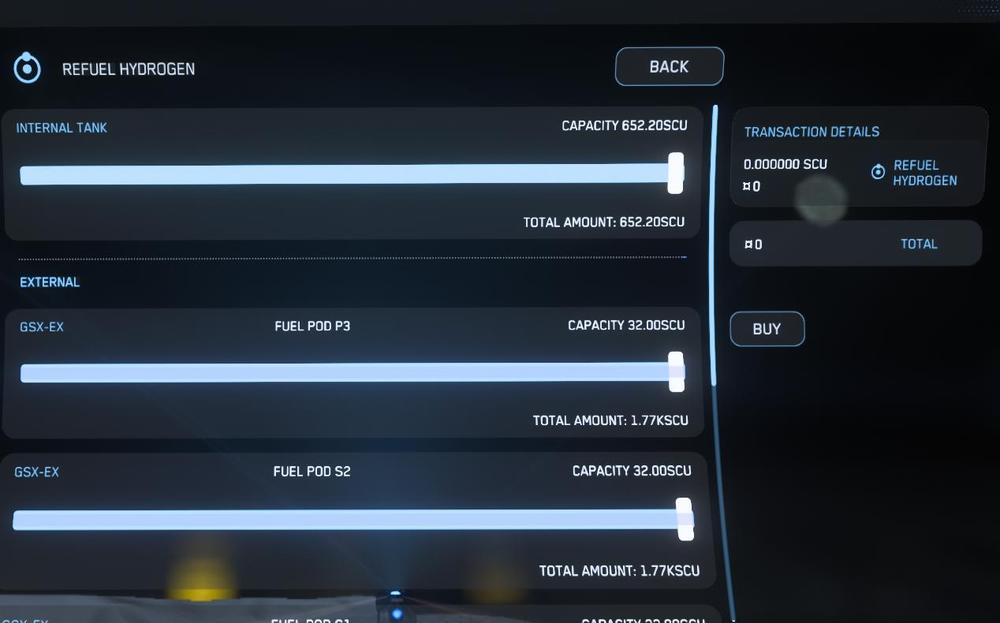

---

**Step 2 — 進入給油模式**

到達任務地點後，切換至 **SCM 模式**，按 **M** 伸出油槍進入給油模式。

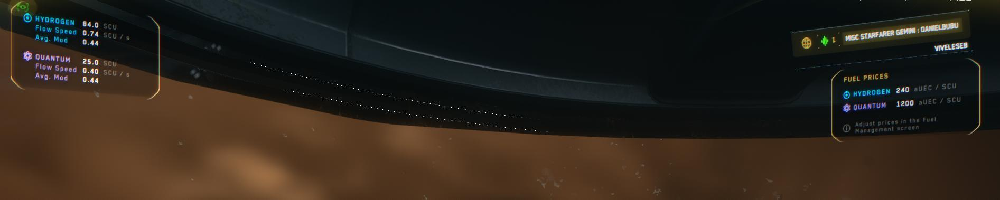
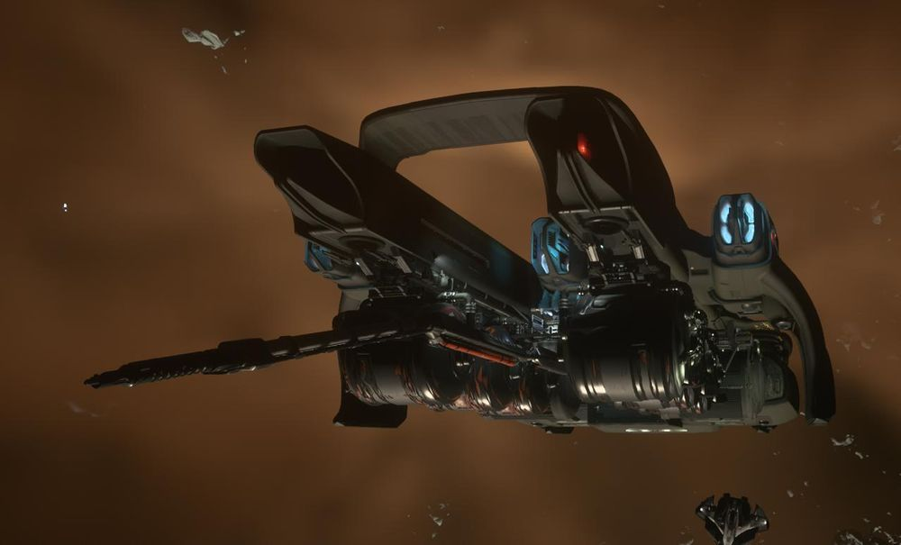

---

**Step 3 — 鎖定目標**

按 **T** 鎖定要加油的目標。

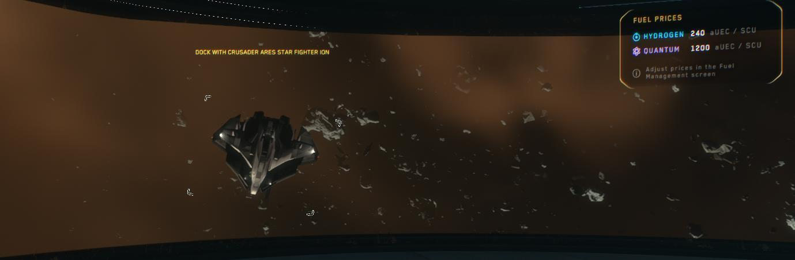

---

**Step 4 — 對準油槍**

確保目標仍處於鎖定狀態，將油槍對準對方。

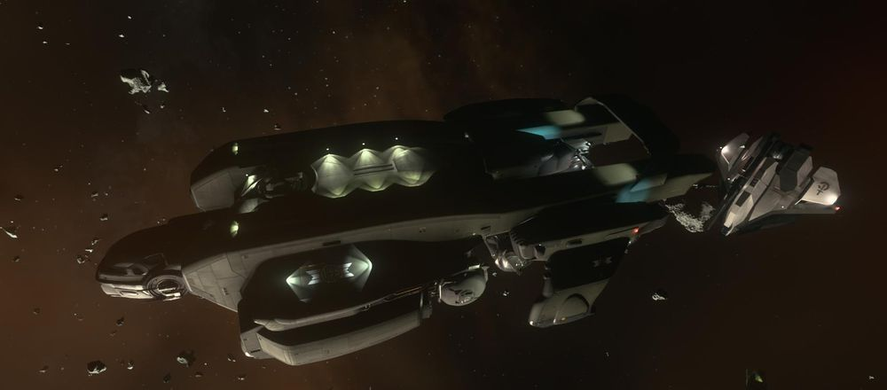

---

**Step 5 — 呼叫對接**

按 **Right Alt+N** 呼叫對接。

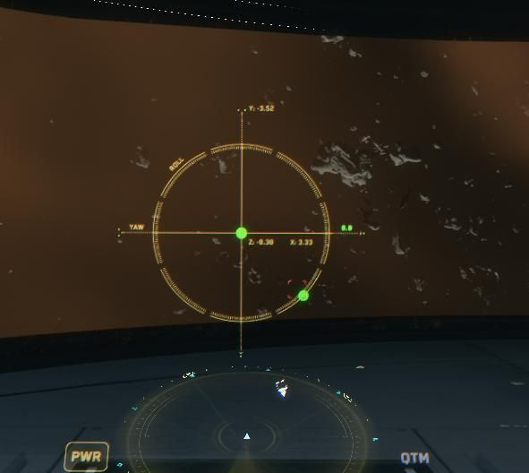

---

**Step 6 — 操作對接面板**

對接成功後找到油桶面板，每個油桶都有：**放油**、**加補油**、**整桶彈出** 三種選項。

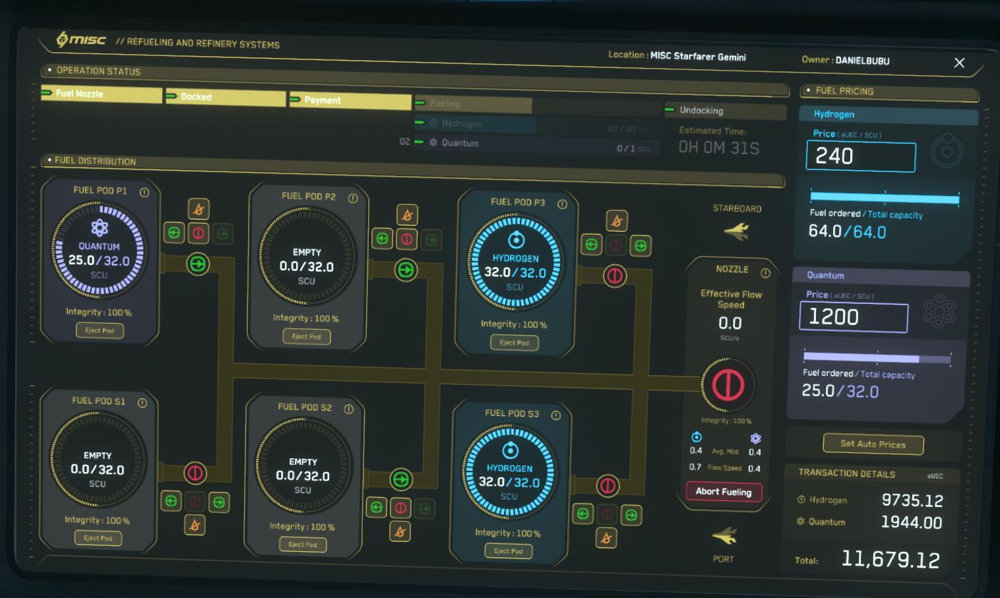

---

**Step 7 — 確認進度**

對接後，**面板和駕駛座都會顯示加油進度**。加滿後自動解除對接。

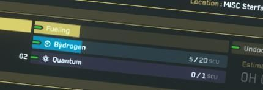
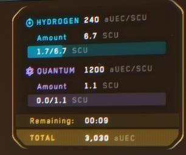

---

<!-- [!WARNING]-->
> 部分任務會生成敵對 NPC，或是「假加油真搶劫」的陷阱，保持警惕！

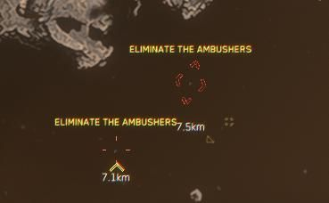

---

<h3>♻️ 4-2. 打撈 / 回收</h3>

 

> 建置中，敬請期待。

---

<h3>📦 4-3. 貨運 / 快遞</h3>

 

貨運主要分為兩種：**手拿包裹**（小型快遞）和**大型 SCU 箱子**（重型貨運）。

---

<h4>🏗️ 4-3-1. 大 SCU 箱子貨運</h4>

 

大箱子需要用**牽引槍（Maxlift）**搬運，可在各太空站 Cargo Deck 購買（見第 3 章）。

**Step 1 — 接任務後取貨**

接完任務後，在取貨地點的機庫貨梯面板可以看到貨物（部分太空站有共用外部貨梯）。

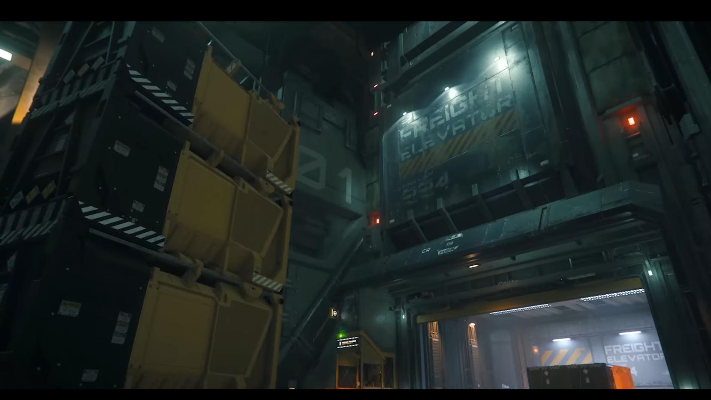
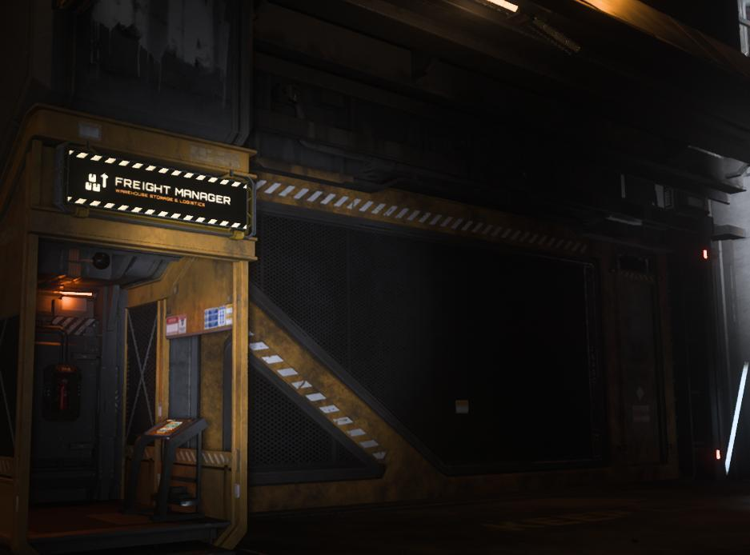
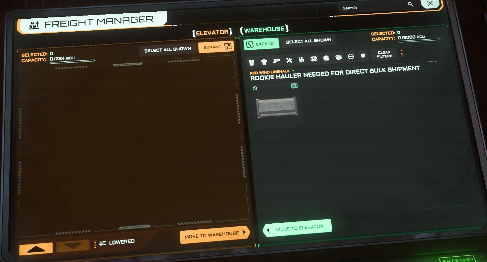

---

**Step 2 — 送貨完成**

將貨物放入目標地點的貨物電梯並拉進去，會出現確認畫面即代表任務完成。

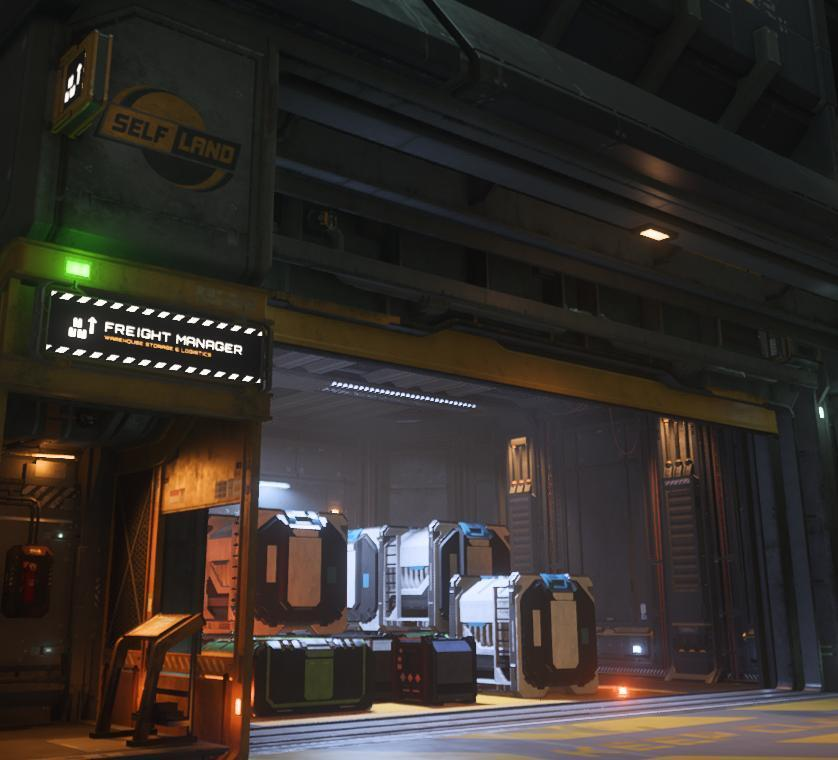
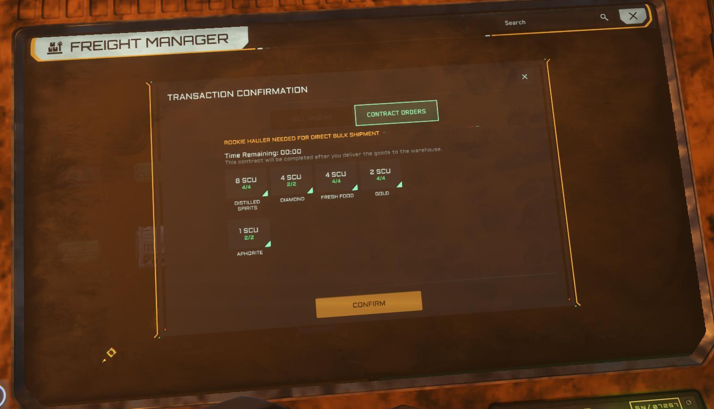

---

<h4>📮 4-3-2. 快遞包裹</h4>

 

包裹可以**用手拿**，部分較小的包裹可以收進背包，來源從殘骸到包裹機都有。

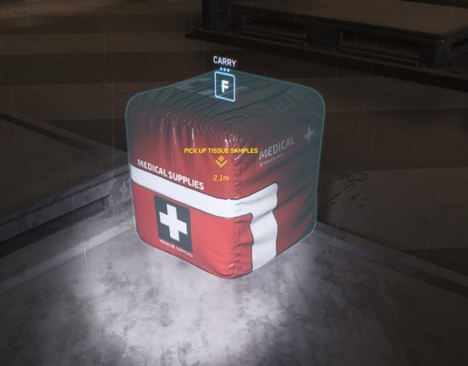
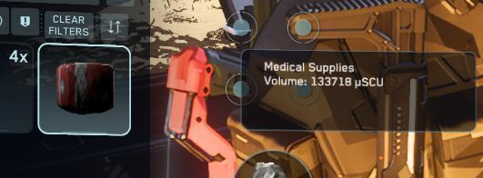

**完成條件：** 將包裹放置在任務指定地點即可。

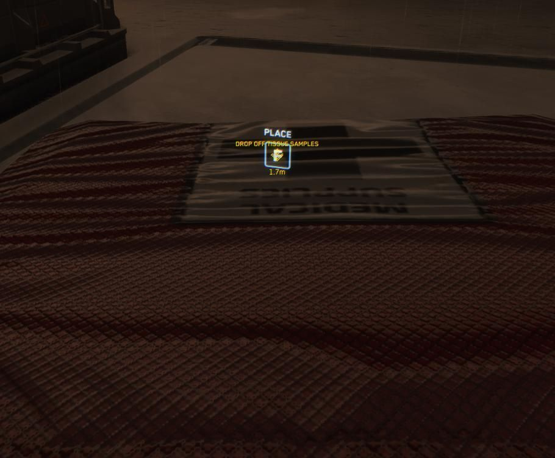

---

<!-- [!TIP]-->
> 部分站點使用**包裹機（Parcel Machine）** 收發包裹，可在太空站購物中心或 Cargo Deck 找到。

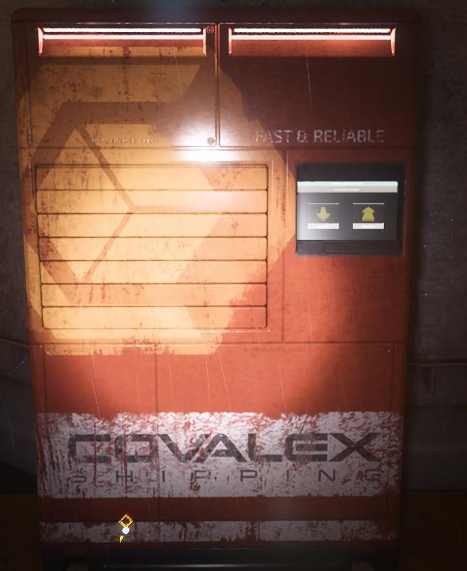

---

<h3>⛏️ 4-4. 生產（礦物、採集、~~畜牧~~）</h3>

 

> 建置中，敬請期待。

---

<h3>⚔️ 4-5. PvPvE</h3>

 

> 建置中，敬請期待。

---

<h3>🔧 4-6. 工程、~~建築~~</h3>

 

> 建置中，敬請期待。

---

<h2>💳 5. 想課金了</h2>

 

不管你是被群友的大船吸引，還是被群友的砲吸引……在網站上買船有幾點要注意：

---

### 💎 信用點（Store Credits）

信用點是**融掉已購買物品**後所產生的，可以在 RSI 網站當美金使用。

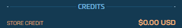

---

### ⚡ Warbond（WB）版本

<!-- [!IMPORTANT]-->
> **Warbond 版本通常比較便宜，但只能用信用卡付款，不能用信用點購買。**

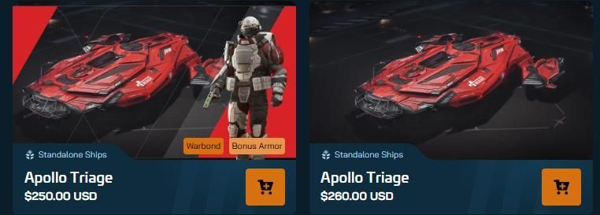

---

### 🔄 CCU 升級券

CCU（Cross Chassis Upgrade）是從一艘船升級到另一艘船的升級券。

<!-- [!TIP]-->
> - 活動期間也有 **WB 版本的 CCU 券**，通常更便宜
> - **不需要持有升級前那艘船**也能購買 CCU 券，可以提前囤積「疊 CCU」

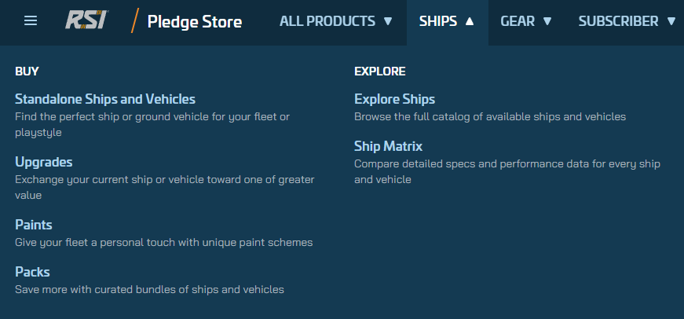

---

### 📊 CCU 範例

> 範例：從 Scorpius 升級到 Apollo Triage，差價 $10 美金

---

### 🔁 融船（Melt）與回購（Buyback）

| 操作 | 說明 |
|------|------|
| **融船（Melt）** | 將已購買物品換回信用點，可在網站內當美金使用 |
| **回購（Buyback / BB）** | 大部分融掉的東西可以買回，但價格有時會變動 |

<!-- [!WARNING]-->
> 融東西前如果不確定，記得先問群友！融了才後悔就麻煩了。

融船按鈕長這樣：

---

<!-- [!CAUTION] -->
> **買貨運船前一定要問群友！** 表定空間大不代表好用，各艦船有各自的雷點與技巧。

---

<h2>↩️ 6. 退款</h2>

 

直接聯繫官方客服申請即可。

**客服連結：**
- [提交退款申請](https://support.robertsspaceindustries.com/hc/en-us/requests/new?ticket_form_id=360000074074)
- [客服入口](https://support.robertsspaceindustries.com/hc/en-us/requests/new)

<!-- [!IMPORTANT]-->
> 內文寫：**"I want to refund ..."**，並記得**先登入帳號**再提交。

---

訂單編號可在以下頁面查詢：
- [帳單頁面](https://robertsspaceindustries.com/en/account/billing)

---

> **星際公民是在玩 bug，不是在玩遊戲。**
> 餅很好吃，但不要吃到拉肚子。
>
> 有其他新手常見問題歡迎提出，我再編輯進去。

---

<h2>📢 廣告區 / 邀請碼</h2>

 

可使用本人的邀請碼註冊：

<!-- [!TIP]-->
> 使用此邀請碼購買資格包後，遊戲內會提供 **5,000,000 aUEC** 給新手，可用來購買黑彎刀 / C1。
> **請主動聯絡我確認是否有收到。**

### 🔗 含邀請碼的帳號註冊連結

**[https://www.robertsspaceindustries.com/enlist?referral=STAR-KYGD-H4NG](https://www.robertsspaceindustries.com/enlist?referral=STAR-KYGD-H4NG)**

---

已有邀請碼的玩家也歡迎加入組織，為未來更新做準備：

| 連結 | 說明 |
|------|------|
| [組織巴哈招生文](https://forum.gamer.com.tw/C.php?bsn=23291&snA=1012&tnum=1) | 巴哈組織介紹頁面 |
| [RSI 組織頁面](https://robertsspaceindustries.com/en/orgs/IJSPF) | RSI 官方組織頁面 |
| [Discord 群](https://discord.gg/sryJKtRYpS) | 加入Discord討論群 |

**Discord ID：** `DanielBUBU`

---

本文整理自巴哈姆特 Star Citizen 討論版
